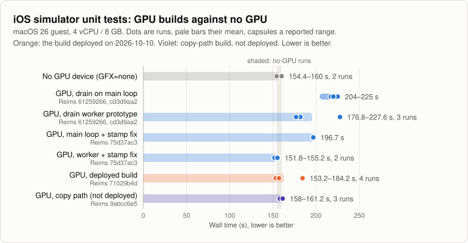
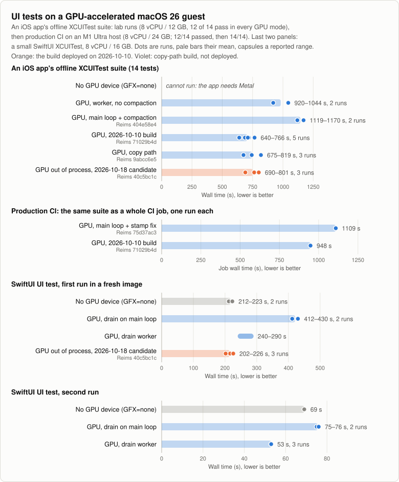
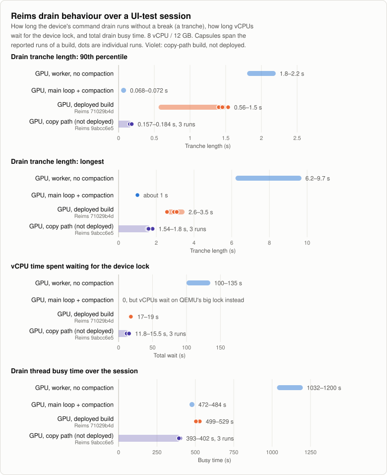
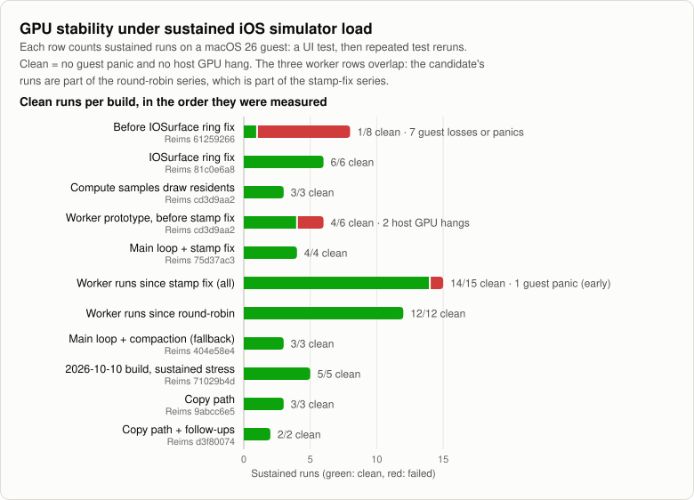
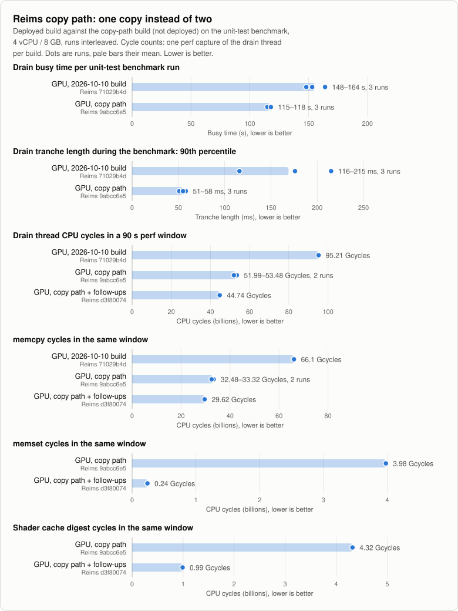
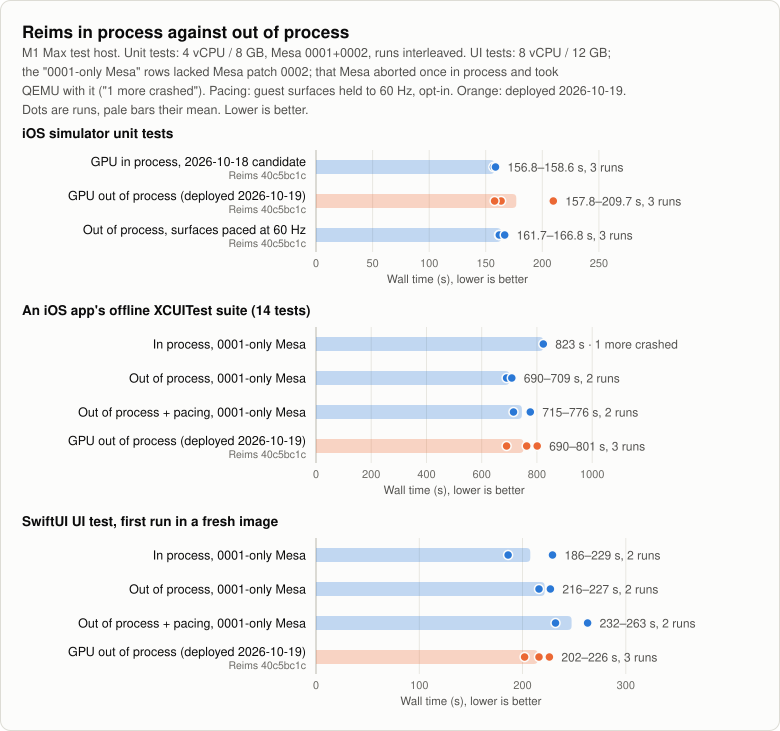
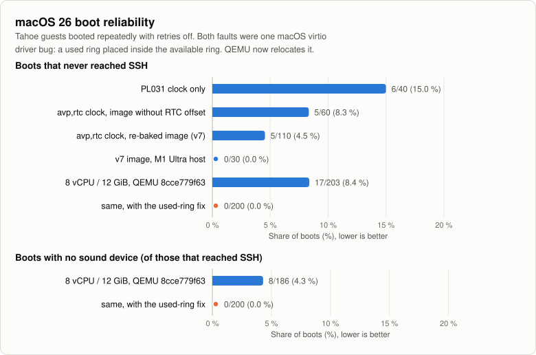

# Performance and reliability

What the macOS-guest work on Asahi Linux has reached, measured. State as of
2026-10-19. The charts are drawn from the CSV files in
[benchmarks/data/](benchmarks/data/) by
[`scripts/plot-benchmarks.py`](../scripts/plot-benchmarks.py); see
[How to update](#how-to-update).

macOS 13 (Ventura) and macOS 26 (Tahoe) guests run under QEMU's `vmapple`
machine with KVM on Fedora Asahi Remix, on Apple silicon Macs. They serve as
ephemeral CI runners for Xcode and iOS-simulator jobs. Reims is the
paravirtual Metal device: the guest's Metal commands are translated
(metal2vulkan) and run on the host's GPU through Vulkan (Mesa's Honeykrisp
driver).

## Highlights

- Since 2026-10-19 production runs Reims out of process: the GPU device is
  its own program and QEMU contains no Reims, Rust or Vulkan code. A host
  GPU driver crash now fails only the job it hit (exit status 120, with the
  reason) and the driver call that crashed is quarantined; in process the
  same kind of Mesa abort took QEMU down with it. On the M1 Max test host the
  app's UI suite took 690–801 s out of process, and simulator unit tests
  157.8 and 163.6 s against 156.8–158.6 s in process (a third out-of-process
  run took 209.7 s: a host-side slowdown that did not repeat). Production
  numbers for the switch are to follow; see
  [Reims out of process](#reims-out-of-process-deployed-2026-10-19).
- macOS 26 guests with GPU-accelerated Metal run on Linux. With the
  2026-10-10 build, CPU-bound simulator unit tests take as long with the GPU
  device as without it: a median of 156.4 s over four runs (153.2–184.2 s),
  against 154.4 s and 160.0 s.
- An iOS app's 14-test XCUITest suite takes 640–766 s on that build, against
  1119–1170 s with the drain on QEMU's main loop: about 1.6x faster. Without
  a GPU the app cannot run its UI tests at all.
- In production CI, the first UI-test job on the 2026-10-10 build passed all
  14 tests for the first time and took 15.8 min, against 18.5 min and 12 of
  14 the day before. That commit also raised two test waits from 10 s to
  30 s, so not all of the gain is the GPU build's.
- A small SwiftUI UI test, run a second time, takes 53 s with the GPU and
  the drain worker, and 69 s without a GPU. The app reaches idle in 3 s
  instead of 22 s (software rendering).
- The longest uninterrupted device drain fell from 6.2–9.7 s to 2.6–3.5 s.
  vCPU time lost waiting for the device fell from 100–135 s to 17–19 s per
  session.
- The 2026-10-11 release copies directly between guest RAM and mapped
  Vulkan memory. The drain thread's CPU cycles in a 90 s window fell from
  95.2 G to 53.5 G with the copy path and to 44.7 G with its two
  follow-ups (no zero-filled placeholder buffers, a cheaper shader-cache
  digest). The sustained tranche p90 fell from 1.40–1.53 s to 157–184 ms
  on the copy path (468–502 ms in the two follow-up runs).
  Test wall times do not change, because the tests are not limited by the
  drain.
- The same release renders Compose/Skia apps: the real UI shows in 14–15
  of 22 XCTest screenshots of an app's UI tests, against 0 of 22 before
  (render pipelines with no fragment function, packed vertex attributes in
  metal2vulkan, and Mesa patch 0002). A cold app launch still takes
  20–40 s before its UI settles, bounded by one queue submission per draw.
- On the production host after the deploy, the simulator unit-test
  benchmark took 72.1 and 73.3 s, against 71.9 and 71.1 s for the previous
  build on the same host and image: no regression.
- Under sustained simulator load: 12 of 12 runs clean since the round-robin
  drain, 5 of 5 sustained stress runs on the 2026-10-10 build (183 of 183 UI
  loops), 3 of 3 out of process (116 of 116 loops, no backend loss), no
  guest panic and no host GPU hang.
- macOS 26 boots that never reached SSH: 17 of 203 before the virtio
  used-ring fix, 0 of 200 after. Boots without a sound device: 8 of 186,
  then 0 of 200.
- The memory balloon nearly halves what an idle guest holds on the host:
  4.84 GB on average instead of 8.78 GB for a 10 GiB guest.

## Charts

### Simulator unit tests

With the drain on QEMU's main loop, GPU guests took 204–225 s, well behind
the no-GPU runs; the first drain-worker prototype took 177–228 s. The stamp
fix brought the main-loop drain to 196.7 s. The drain worker on top of it
brought GPU guests into the no-GPU band (shaded). The 2026-10-10 build stays
close to it: three of its four runs are inside or just below the band, one
took 184.2 s. The copy-path build (158.0–161.2 s) is no faster here, because
this benchmark does not wait on the drain. The last three M1 Max rows are
the out-of-process validation
(see [Reims out of process](#reims-out-of-process-deployed-2026-10-19)).
Pale bars are medians in every chart here, so the one-off 209.7 s
out-of-process run shows as its own dot but does not pull its row's bar.

The lower panel ran on the production host (M1 Ultra) with the production
image after the 2026-10-11 deploy
(see [Production host check](#production-host-check-2026-10-11)). That image
has the simulator pre-warmed, so its runs are about twice as fast; the two
panels have separate scales and are not comparable.

### UI tests

Top: the app's suite is about 1.6x faster on the 2026-10-10 build than with
the drain on the main loop. The copy-path build ran it in 675–819 s, within
the noise of the 2026-10-10 build's 640–766 s. Second: the same suite as a production CI job, one
run per build; the 2026-10-10 run passed 14 of 14 (12 of 14 before), with
two test waits raised from 10 s to 30 s in the same commit and an unrelated
low-priority CPU load on the host, so its time is conservative. Below: with the drain worker a small SwiftUI test is
faster with the GPU than without one once the simulator is warm; the first
run in a fresh image still pays for one-off simulator setup in every mode.
The orange rows are the out-of-process build deployed on 2026-10-19 (three
sustained runs on the M1 Max).

### Drain behaviour

A tranche is how long the device drains guest commands without a break. The
main-loop build has the shortest tranches, but its vCPUs wait behind QEMU's
big lock instead, which showed up as dropped SSH sessions. The 2026-10-10
build keeps the worker. Against the worker build without compaction it cuts
the longest tranche by more than half and the vCPU wait by over 80 %. The
copy-path build cuts the tranche p90 to 157–184 ms, the longest tranche to
1.5–1.8 s and busy time to 393–402 s. The two follow-up runs (419–439 s
busy, p90 468–502 ms) ran a different load mix (the app's own UI-test stage
was skipped), so they are not a like-for-like comparison.

### Stability

Before the IOSurface ring fix, 7 of 8 long runs lost the guest. Every series
since has been clean except the worker prototype before the stamp fix (two
host GPU hangs) and one early guest panic in the worker series.

### Copy path

The 2026-10-10 build moved guest data through an intermediate buffer: guest
pages into a heap buffer, then into Vulkan staging memory, and readbacks the
same way back. The copy-path build (Reims 9abcc6e523, branch `gpu-copy`)
copies directly between guest RAM and mapped Vulkan memory. On the unit-test
benchmark, with runs interleaved, drain busy time fell from 148–164 s to
115–118 s and the tranche p90 from 116–215 ms to 51–58 ms. In one 90 s perf
window per build, the drain thread used 53.5 G cycles instead of 95.2 G, and
`memcpy` 33.3 G instead of 66.1 G. The benchmark's wall time did not move
outside noise (three interleaved runs each: mean 164.8 s, range 153.2–184.2 s,
against 160.0 s, 158.0–161.2 s), because that test is not limited by the drain. Three
sustained runs were clean (114 of 114 loops).

Two follow-ups (Reims d3f8007474) removed the next costs the profile showed.
A storage binding the device already held still got a zero-filled buffer of
the full image, used only for its length: about 7.5 % of the drain's cycles
in `memset`. And every pipeline lookup hashed the shader's whole AIR blob
with SipHash: 8.4 %. With both gone the drain thread used 44.7 G cycles in
the same 90 s window instead of 52.0 G (53.5 G in the first capture),
`memset` 0.24 G instead of 3.98 G and the digest 1.0 G instead of 4.3 G.
`memcpy` is now about two thirds of what remains: Honeykrisp cannot import
guest RAM, so data is still copied once each way. Two sustained runs were
clean (85 of 85 loops). The copy path and its follow-ups are in the
2026-10-11 release.

### Rendering (2026-10-11 release)

Compose and other Skia apps draw stencil passes with render pipelines that
have no fragment function. Reims refused those pipelines, so the cover
passes drew nothing and every XCTest screenshot of such an app came out as
the clear colour: 0 of 22 screenshots of an app's UI tests showed its UI.
The release builds those pipelines with an empty fragment stage, asks an
object's type before treating it as a texture view, and takes a
metal2vulkan fix for packed vertex attributes read through a byte pointer
(1,746 draws a run were skipped before). That exposed a Mesa bug: a 16-bit
flat fragment input (a Skia vertex colour) aborted the shader compiler, and
QEMU with it. `patches/mesa/0002` fixes it, and a GPU host must run a Mesa
built with it before it runs this Reims. With all three, 14–15 of the 22
screenshots show the real UI. The rest are taken during a cold launch: an
app needs 20–40 s before its UI settles, because the drain is saturated by
the per-draw path (one queue submission per draw, about 170 µs each), not
by the GPU or by shader compilation.

### Production host check (2026-10-11)

After the deploy, the unit-test benchmark ran twice on the production host
(M1 Ultra) with the production GPU image and 4 vCPU / 8 GB, then twice with
the previous build and previous Mesa: 72.1 and 73.3 s against 71.9 and
71.1 s, drain busy 76–78 s against 75–76 s. The production image has the
simulator pre-warmed, so these runs are about twice as fast as the M1 Max
runs above and are not comparable with them. Reims' Vulkan pipeline cache
now persists across host reboots (`~/.cache/reims-vgpu`); the second run on
each build loaded it (5.1 MB).

### Reims out of process (deployed 2026-10-19)

Reims runs as `reims-vgpu-backend`, behind a small QEMU device
(`apv-gpu-proxy`) that talks to it over a unix socket, shared memory and
eventfds. QEMU then contains no Reims, Rust or Vulkan code. A crash in the
host GPU driver ends only the backend: the job fails with exit status 120 and
the reason, the guest is discarded, and the driver call that crashed is
refused on later runs until the driver changes. The QEMU fork's KVM code is
rewritten, and the original author's macOS-host changes are reverted to
upstream. `MODE=oop scripts/build-qemu.sh` builds the pair, and the runner
switches a GPU slot to it with `GPU_BACKEND_BIN`; unsetting it falls back to
the in-process build from Reims' `vendor/qemu` pin. Reims 40c5bc1c38 and
QEMU c6d87a8406 are merged and went into production on 2026-10-19.

**Unit tests** (M1 Max, 4 vCPU / 8 GB, Mesa with both patches, the three
arms interleaved): 156.8–158.6 s in process; 157.8 and 163.6 s out of
process, plus one 209.7 s run. In that run the drain's per-draw cost was 2.5
times the others' and the simulator's start-up animation ran 159 s instead of
about 110; nothing in the guest's work or the host's journal explains it, and
it did not repeat. Out of process, completions reach the guest about 2 ms
sooner, and the simulator's compositor, which is paced by nothing else,
redraws its screen about 92 times a second instead of 67, taking guest CPU
from the tests.

**UI tests** (8 vCPU / 12 GB). Three sustained UI-load runs out of process:
the SwiftUI probe in 202–226 s, the app's offline UI suite in 690–801 s
(12/14 each, the two tests that also fail in process), 38–39 load loops
each, no backend loss, no guest panic. An earlier A/B on a Mesa that by
mistake lacked patch 0002 (the "0001-only Mesa" rows) compared the modes
directly: the probe took 186 and 229 s in process against 216 and 227 s out
of process, and the suite 823 s in process against 690 and 709 s. The second
in-process suite run never finished: the Mesa shader-compiler abort that
0002 fixes killed QEMU (exit status 255) with the guest. Out of process the
same class of abort ends the backend only: the job fails cleanly with "GPU
backend lost" and the call is quarantined.

**Lifecycle** (out of process, the final build):

| Test | Result |
|---|---|
| Backend killed (SIGKILL) mid-job | job fails in 2 s, exit status 120, reason logged; no backend left behind |
| The next job on the same host | runs normally (simulator boots, screenshot taken) |
| No job arrives (idle timeout) | exit status 123, as in process |
| Job runs too long (job timeout) | exit status 124, as in process |
| Backend lost while a timed-out job is being stopped | stays 124; the loss is logged |

**Refresh-rate cap.** `GPU_MAX_REFRESH_HZ` (default 60) caps the paravirtual
display's modes and VBL; it is on by default. macOS 26 never arms that VBL,
so it does not pace the simulator. Pacing the simulator's screen to 60 Hz is
possible (`GPU_FRAME_PACING=1`): its compositor queues dozens of frames
ahead, so the device has to hold their completions until its queue is full,
and every completion on that channel then trails by up to a second. It
costs UI time: on the 0001-only Mesa the probe took 263 and 232 s paced
against 227 and 216 s unpaced, and the app's suite 715 and 776 s against
690 and 709 s. On unit tests it makes no clear difference (161.7–166.8 s
paced, final build). Surface pacing is therefore opt-in.

### Production switch to out of process (2026-10-19)

The production GPU slot has run out of process since the morning of
2026-10-19. The first attempt failed at boot and was rolled back to the
in-process build within minutes: the runner kept the backend's socket in the
job's run directory, and with the checkout under a long home directory that
path was about 136 bytes, more than the 107 a unix socket path can hold. The
backend could not bind it and QEMU exited during boot. `vm-run.sh` now puts
the socket in the runtime directory beside the QMP socket, and
`launch-kvm.sh` refuses a path that is too long with a clear message.

<!-- First production numbers for the out-of-process GPU slot go here:
     unit-test benchmark on the production host (as in the 2026-10-11
     check) and the first UI-test CI jobs. -->

No production CI job has run on it yet; production numbers to follow.

### Draw batching (not deployed)

On Reims branch `draw-batch`, draws in one render pass share a command buffer
and a submit. Drain time per draw fell 27 % (584–686 µs to 448–507 µs) and
the engine's draw phase 55 %. The time to the first settled frame after a
cold launch did not change measurably: in most of the 20–30 s launches the
device was idle and the wait was in the guest. It has not been validated
under load, and it is not merged.

### Boot reliability

The real-time clock work lowered the early-boot stall, but it only went away
with the used-ring relocation in QEMU, which also fixed the missing sound
device.

### Memory balloon

The governor gives an idle guest's spare memory back to the host. During a
job that needs nearly all of its 10 GiB, it hands the memory back to the
guest and the average saving is small. Peaks: 10.09 GB idle without the
balloon against 6.67 GB with it; about 10.5 GB for the job either way.

## How the bugs were found

On the production GPU slot the guest stalled for several seconds at a time,
and UI tests appeared to run about 4x slower than without the GPU. The causes were
separate bugs, found one at a time from Reims' per-run event counts, `perf`
profiles and guest crash data.

- **A completion was reported out of order.** When the device refused a
  command packet, it wrote that packet's completion word at once, even if
  an earlier packet in the same channel was still queued. The guest read
  the word as "everything up to here is done", freed the earlier packet's
  objects and reused its memory. The queued packet then ran on garbage: in
  one case a Core Animation compute kernel read float data as a loop count,
  ran about a billion iterations and the host GPU timed the job out. Fix:
  hold the word until the channel reaches it (Reims 25e4dc0e32).
- **Object ids collided across guest processes.** Each guest process
  numbered its objects from 1, and the device keyed some state on the number
  alone. Three processes with a pipeline in the same slot shared one entry,
  which caused 362 refused packets in one run. Fix: a separate number range
  per process (Reims dcfcfadb95).
- **The dependency graph never shrank.** Finished work was marked dead but
  never removed, so admitting each new packet walked the whole session's
  history. Twenty minutes into a UI-test session that was 30 % of the drain's
  CPU time, spent while holding QEMU's big lock. Fix: compact the graph as
  part of admission (Reims 404e58e41f). It no longer shows in the profile.
- **The drain ran under QEMU's big lock.** The device drained in a main-loop
  bottom half, so every vCPU exit that needed the lock waited out the whole
  tranche. Fix: drain on a worker thread (QEMU 6740a49344), end a tranche at
  the next packet when a vCPU waits for the device (Reims 75d37ac33f), and
  take busy channels in turns of one packet (Reims 7c87a66833).

Earlier fixes on the way to a stable GPU guest:

- **The IOSurface request ring was read without wrapping.** Once the guest's
  request counter passed the ring size, every map and unmap request was read
  from beyond the ring and lost. The guest freed surface memory that the
  device kept writing frames into, and the guest kernel panicked with
  corrupted page tables. One fault address was a half-float pixel value in a
  kernel pointer. Fix: Reims 81c0e6a8f9.
- **The device described itself before it existed.** The guest asks for the
  GPU's limits once per boot, before the first draw, and got the Vulkan
  floor: one sample per pixel. The iOS simulator then created 4x MSAA
  textures, Metal's validation aborted the simulator's GPU host process, and
  SpringBoard restarted in a loop. Fix: bring the device up first (Reims
  6125926602).
- **A used ring inside the available ring.** macOS 26's virtio driver
  sometimes programs a used-ring address that lies inside the available
  ring. Completions then land where the driver never looks: on the network
  control queue the guest never configures its network (the boot stall); on
  the sound control queue the sound device never registers. Fix: QEMU
  relocates such a used ring (`x-fix-overlapping-used`, QEMU 6f2d0742e8).

Known gaps on the deployed build (out of process since 2026-10-19):

- A cold app launch takes 20–40 s before its UI settles. Screenshots taken
  early in a launch can still show a splash screen or flat colour. Batching
  draws (not deployed) cuts the device's per-draw cost but did not shorten
  the launch measurably.
- `memcpy` is about two thirds of the drain's CPU time. Honeykrisp cannot
  import guest RAM, so guest data is copied into and out of Vulkan memory
  once each way.

## Methodology

- **Hosts:** an Apple M1 Max Mac (MacBook Pro class) for the measurements
  here, except the "M1 Ultra host" boot row. Fedora Asahi Remix 44, Asahi 16K
  kernel 7.1 with this repository's KVM patches, QEMU from
  aquarat/qemu-reims-vgpu, Reims from aquarat/reims-vgpu, Mesa Honeykrisp
  with the varying fixes (`patches/mesa/`, `scripts/build-mesa-honeykrisp.sh`;
  0002 from the 2026-10-11 release on, except the rows labelled "0001-only
  Mesa").
- **Guest:** macOS 26.4 (25E246), Xcode 26.4.1, iOS 26.4.1 simulator
  runtime, images built as in [IMAGES.md](IMAGES.md). Guest size per
  benchmark is given on each chart.
- **Simulator unit tests:** wall time of the simulator unit-test phase of a
  benchmark script, 4 vCPU / 8 GB guest.
- **App XCUITest suite:** an iOS app's 14 offline XCUITests from prebuilt
  test products, 8 vCPU / 12 GB guest. 12 of 14 pass in every GPU mode; the
  two failures are waits on system dialogs (a document picker and an import
  confirmation). The app is built with
  Compose Multiplatform and crashes or never renders without Metal.
- **Production CI job:** the same 14 UI tests as one job on the GPU slot of
  an M1 Ultra host (8 vCPU / 24 GB guest), timed from job start to end
  including setup before and after the tests. The tests themselves summed
  to about 403 s on the 2026-10-10 run.
- **SwiftUI UI test:** one small XCUITest, 8 vCPU / 16 GB. "First run" is
  the first `xcodebuild test` in a fresh image (it includes about two minutes
  of one-off simulator setup in every mode); "second run" repeats it after
  shutting the simulator down.
- **Drain figures:** Reims' own counters over a UI-test session; each
  capsule spans the runs of one build.
- **Charts:** dots are single runs and pale bars the median of a build's
  runs (with two runs, their mean).
- **Copy path:** the unit-test benchmark run three times per build,
  alternating builds, plus one `perf` capture per build of the drain thread
  over a 90 s window (DWARF call graphs). The follow-ups were compared the
  same way, one `perf` capture each.
- **Rendering:** the 22 screenshots XCTest takes during the app's UI tests,
  counted as showing the app's UI or not (images not published).
- **Production host check:** the same unit-test benchmark on the M1 Ultra
  production host, production GPU image, 4 vCPU / 8 GB, one guest at a time
  with the runner stopped. Sustained figures come from three
  sustained runs of the copy-path build against three of the deployed
  build.
- **Out of process:** the unit-test benchmark three times per arm (in
  process, out of process, out of process with surface pacing), arms
  interleaved, on one Reims tree built both ways. UI load: three sustained
  runs. Lifecycle: one job per case, the backend killed with SIGKILL.
- **Sustained runs:** a UI test followed by repeated test reruns ("loops").
  A run is clean with no guest panic and no host GPU job timeout.
- **Boots:** [`scripts/debug/boot-reliability.sh`](../scripts/debug/boot-reliability.sh),
  retries off; a boot fails if SSH never answers.
- **Balloon:** see "Memory balloon" in [NOTES.md](NOTES.md). The host was
  shared with other VMs, so wall times varied by about ±15 %.
- Every value is a measured run or a range reported for a set of runs. The
  `source` column of each CSV says where it came from.

## How to update

1. Add rows to the CSV in [benchmarks/data/](benchmarks/data/), one row per
   run:
   - `unit-test.csv`, `ui-tests.csv`, `drain.csv`, `balloon.csv`,
     `copy-path.csv`:
     `date,series,run,reims,qemu,metric,value,unit,source`.
   - `ranges.csv`: results known only as a range, or a note such as "cannot
     run".
   - `reliability.csv`: clean and total sustained runs per build.
   - `boot.csv`: failures and boots per configuration.
2. A new build needs a line in `series.csv` (label, colour role
   `reference`, `main`, `highlight` for the deployed build or `next` for a
   measured but undeployed one, description). Rows follow the order
   of `series.csv`, so keep it chronological. A new metric needs a line in
   `metrics.csv`.
3. Run `scripts/plot-benchmarks.py` (Python 3, standard library only). It
   rewrites `docs/benchmarks/*.svg`. `--check` validates the data without
   writing anything.
4. Update the highlights above if a headline number changed.

`copy-path.svg` is drawn from `copy-path.csv`, one panel per metric in
the order they first appear. `oop-vs-inprocess.svg` takes the unit-test and
UI-test rows of the series whose id starts with `inproc-` or `oop-`;
series whose id ends in `-ab` appear only there, not in `ui-tests.svg`.
